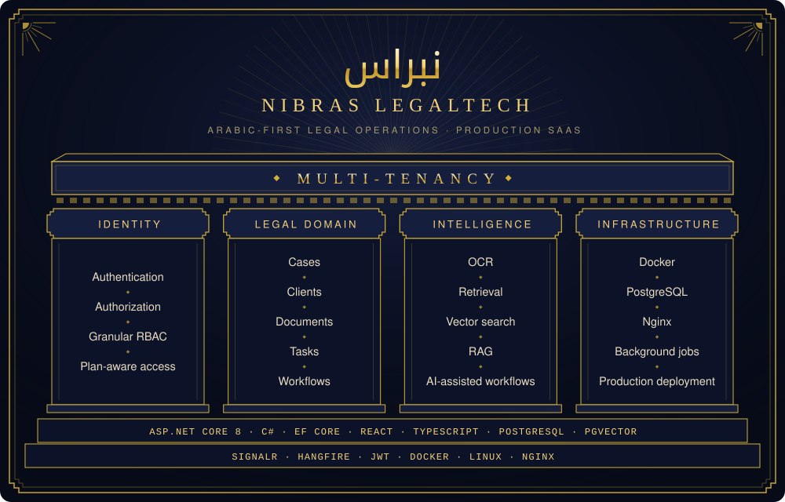
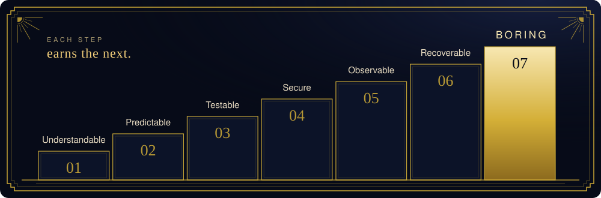
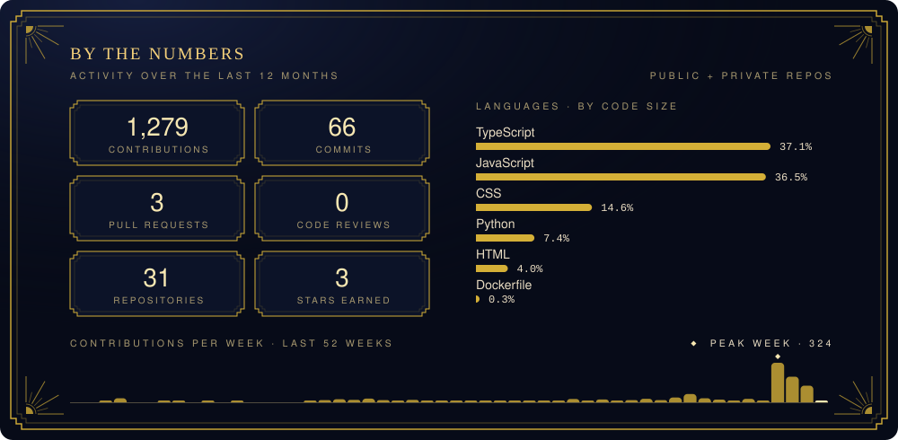

<div align="center">



<a href="https://mohammad-s-digital-presence.vercel.app/"></a>&nbsp;&nbsp;
<a href="mailto:ksjxixi@gmail.com"></a>

</div>

<br />


```csharp
var me = new Engineer
{
    Name      = "Mohammad Abukhadija",
    Role      = "Software Engineer",
    Focus     = ["Backend", "Full-Stack", "SaaS", "AI", "Infrastructure"],
    Currently = "Building production software and AI-powered systems",
    Location  = "Jordan",
    Speaks    = ["Arabic · Native", "English · C2", "French · B1", "Spanish · B1"],
};
```

I build software from the **inside out**.
Not just interfaces. Not just APIs. Not just models. I care about the entire machine:



My favorite problems live where multiple systems collide: **multi-tenancy, authorization, distributed workflows, AI integration, data, infrastructure**, and the ugly edge cases nobody noticed until production.

<br />


<table align="center">
<tr>
<th align="left">◆&nbsp; SYSTEMS</th>
<th align="left">◆&nbsp; INTELLIGENCE</th>
<th align="left">◆&nbsp; INFRASTRUCTURE</th>
</tr>
<tr>
<td valign="top">
<ul>
<li>Multi-tenant SaaS</li>
<li>Domain-heavy platforms</li>
<li>REST APIs</li>
<li>IAM / RBAC</li>
<li>Realtime systems</li>
<li>Background processing</li>
<li>Workflow engines</li>
<li>Third-party integrations</li>
</ul>
</td>
<td valign="top">
<ul>
<li>RAG systems</li>
<li>Vector search</li>
<li>OCR pipelines</li>
<li>AI-assisted workflows</li>
<li>Agent orchestration</li>
<li>Structured AI outputs</li>
<li>Context &amp; memory systems</li>
<li>LLM integrations</li>
</ul>
</td>
<td valign="top">
<ul>
<li>Linux</li>
<li>Docker</li>
<li>Nginx</li>
<li>PostgreSQL</li>
<li>Redis</li>
<li>Object storage</li>
<li>CI/CD</li>
<li>Production operations</li>
</ul>
</td>
</tr>
</table>

<br />


**An Arabic-first legal operations platform, built as production SaaS.**
I'm the **Project Manager / Lead Software Engineer**, and it's where most of my engineering interests converge.



<table align="center">
<tr><th colspan="2" align="left">◆&nbsp; ENGINEERING WORK</th></tr>
<tr>
<td valign="top">
<ul>
<li>Multi-tenant architecture &amp; tenant isolation</li>
<li>Identity &amp; granular authorization</li>
<li>Plan-aware access control</li>
<li>Case &amp; legal workflow systems</li>
<li>Document management</li>
<li>Realtime functionality</li>
<li>Background processing</li>
</ul>
</td>
<td valign="top">
<ul>
<li>OCR pipelines</li>
<li>Retrieval &amp; vector search</li>
<li>AI-assisted legal workflows</li>
<li>Legacy workflow modernization</li>
<li>Production deployment &amp; infrastructure</li>
<li>Database architecture &amp; migrations</li>
</ul>
</td>
</tr>
</table>

<br />


> I don't particularly care about making code *look* clever. I care about making systems:



<p align="center"><i>Because boring software is usually the software that keeps working.</i></p>



<br />


<p align="center">
<sub><b>LANGUAGES &amp; FRAMEWORKS</b></sub><br /><br />

</p>

<p align="center">
<sub><b>DATA &amp; INFRASTRUCTURE</b></sub><br /><br />

</p>

<p align="center">
<sub><b>ENGINEERING TOOLS</b></sub><br /><br />

</p>

<br />


```text
 01 │ Production SaaS architecture
 02 │ Identity, authorization & access-control systems
 03 │ AI-agent orchestration for software engineering
 04 │ AI-native legal workflows
 05 │ Retrieval, context & structured AI systems
 06 │ Infrastructure and deployment reliability
 07 │ Turning complicated systems into understandable ones
```

<br />




<br />


I enjoy understanding systems at the level where the abstraction stops being useful.

- Why does the request fail?
- Why does the authorization decision happen *here*?
- Why is this query slow?
- What happens when the worker dies?
- What happens when two tenants touch the same resource?
- What happens when the AI is wrong?
- What happens when production disagrees with localhost?

Those questions are usually more interesting than writing the first version.

<br />

<div align="center">




</div>
